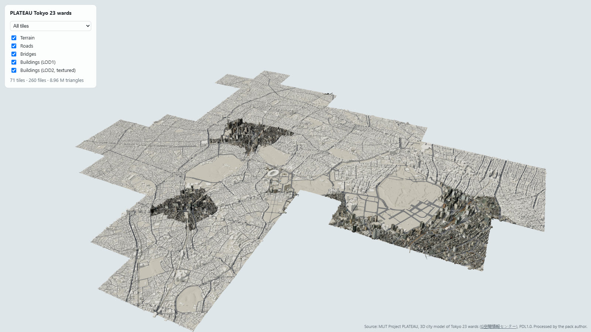
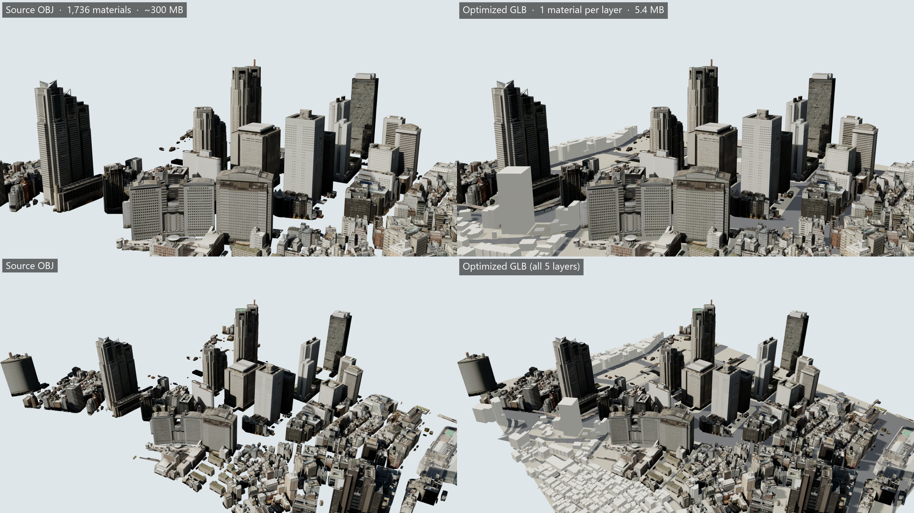

# plateau-tokyo-glb

Real Tokyo as web-ready GLB tiles: **Chiyoda, Shinjuku and Shibuya** from MLIT's Project PLATEAU 3D city model, cut into 71 mesh tiles of about 1 km, placed in one shared metric frame, optimized for three.js / WebGL. Includes a static viewer.



## Numbers

| | |
|---|---|
| Tiles (3rd-level standard mesh, ~1 km) | **71** (every mesh touching Chiyoda, Shinjuku or Shibuya) |
| GLB files | **260** |
| Triangles | **8.96 M** |
| Pack size | **146 MB** of GLB (150.6 MB with viewer, thumbnails and scripts) |
| Source read for it | **1.86 GB** of OBJ + JPEG/PNG, out of the 2.24 GB OBJ archive |
| Source textures | **13,968** facade images (1.05 GB) → **47** atlases, one per textured file |
| LOD1 blocks | 47,678, of which 12,149 are dropped because the same building is in the LOD2 file |

Per layer:

| Layer (`layer`) | Files | Triangles | GLB | Notes |
|---|---:|---:|---:|---|
| `dem`: terrain (DEM TIN) | 71 | 1,862,240 | 11.5 MB | smooth normals |
| `tran`: roads (LOD1 road surfaces) | 71 | 1,117,359 | 9.3 MB | clipped from the 10 km road files by triangle centroid |
| `bldg_lod1`: buildings, block models | 71 | 4,067,340 | 55.5 MB | only buildings with no LOD2 version |
| `bldg_lod2`: buildings with photo facades | 26 | 1,848,527 | 61.8 MB | atlased, single material |
| `brid`: bridges and elevated roads | 21 | 61,443 | 8.1 MB | atlased, single material |

**Proof tile, 53394525 (West Shinjuku, Tokyo Metropolitan Government Building):**

| | Source | This pack |
|---|---:|---:|
| LOD2 buildings | 9.55 MB OBJ + 1,715 textures (267.7 MB) | 4.02 MB GLB, 1 material |
| Bridges | 0.61 MB OBJ + 21 textures (21.6 MB) | 0.90 MB |
| LOD1 buildings | 2.15 MB OBJ | 0.22 MB (788 of 1,382 blocks replaced by LOD2) |
| Terrain | 1.28 MB OBJ | 0.12 MB |
| Roads | clipped from a 122.6 MB 10 km file | 0.09 MB |
| **Total** | **~300 MB, 1,736 materials** | **5.35 MB, 5 draw calls** |



Same camera and light. Left: the untouched OBJ with all 1,715 original textures. Right: this pack.

## What was done to the data

1. **Read only what was needed** from the official OBJ archive by HTTP range requests (single tiles, no 2 GB download).
2. **One frame for all tiles.** Source coordinates are JGD2011 / Japan Plane Rectangular CS IX (EPSG:6677), metres. Every GLB uses
   `X = E − E0`, `Y = height (T.P. m)`, `Z = −(N − N0)` with `E0 = −10000`, `N0 = −35500` (near Akasaka). glTF is Y-up, so tiles drop into any scene at the right place with no transform. `tiles.json` and every row of `metadata.jsonl` repeat this.
3. **Texture atlas.** Each texture is cropped to the UV area actually used, all are scaled to one texel density per file and packed into one atlas (4096 px wide; height trimmed to the next power of two). Faces without UVs get a solid patch. One material per file instead of hundreds.
   The trade-off: dense tiles keep less texel resolution (`texel_scale` per row: 0.10 for West Shinjuku, 1.0 for sparse tiles). It holds at district scale (see the proof still); very close street-level views are softer than the source.
4. **LOD1/LOD2 de-duplication.** LOD1 blocks whose centroid falls inside a rasterised LOD2 footprint on the same tile are removed, so the two building layers can be shown together without doubling.
5. **Roads** come in 10 km files; each triangle is assigned to the 1 km mesh that contains its centroid.
6. **Compression** with glTF Transform 4.5: weld, WebP textures (quality 82), meshopt with quantization. Use `MeshoptDecoder` in three.js (`GLTFLoader.setMeshoptDecoder`).

Scripts that built the pack are in `scripts/` (`build_tile.py`, `build_pack.py`, `optimize.sh`).

## Layout

```
tiles/<mesh>/<mesh>_<layer>.glb   layer = dem | tran | brid | bldg_lod1 | bldg_lod2
thumbs/<mesh>.jpg                 640x360 render of each tile
tiles.json                        index for the viewer: mesh, wards, bbox (local m), files, centre lat/lon
metadata.jsonl                    one row per GLB (see below)
viewer/                           static three.js r170 viewer (MIT, bundled)
```

`metadata.jsonl` fields: `file_name`, `mesh_code`, `layer`, `layer_description`, `wards`, `thumbnail`, `triangles`, `vertices`, `glb_bytes`, `sha256`, `source_obj_bytes`, `source_texture_bytes`, `source_textures`, `atlas`, `texel_scale`, `textured`, `mesh_bounds_latlon` `[lat0, lon0, lat1, lon1]`, `bbox_local_m`, `frame`, `source`, `license`, plus `lod1_buildings_total` / `lod1_dropped_as_lod2` on LOD1 rows.

## Viewer

Browsers do not load files from `file://`, so serve the pack folder:

```
cd plateau-tokyo-glb
python -m http.server 8000        # or: npx serve .
# open http://localhost:8000/viewer/
```

Options: `?ward=Shinjuku`, `?tiles=53394525,53394526`, `?layers=dem,tran,bldg_lod2`, and `?shot=x,y,z,tx,ty,tz,fov` for a fixed camera without the UI (used for the thumbnails).
Measured on an RTX 3060 in Chrome: all 71 tiles (8.96 M triangles) load and draw in about 5 to 7 s.

## Licence and credit

The data is the **3D City Model (Project PLATEAU), Tokyo 23 wards**, published by the Ministry of Land, Infrastructure, Transport and Tourism (MLIT) on G空間情報センター:
https://www.geospatial.jp/ckan/dataset/plateau-tokyo23ku

- The dataset's licence field points to **PLATEAU Site Policy §3 「コンテンツの利用」** (https://www.mlit.go.jp/plateau/site-policy/). It says the copyright in the 3D city model open data published on G空間情報センター **belongs to each local government** (「各地方公共団体に帰属」), and that the content may be used under the **Public Data License 1.0 (PDL1.0)**, https://www.digital.go.jp/resources/open_data/public_data_license_v1.0 .
- PDL1.0 allows copying, public transmission and adaptation, **including commercial use**, so a **modified copy may be redistributed**. It requires a source credit and a separate statement that the content was edited. Edited content must not be presented as if the government made it. The site policy also states compatibility with CC BY 4.0.
- Some content may be restricted by individual laws (the site policy names the Survey Act, 測量法). Check the PLATEAU survey manual before uses beyond visualisation.

**Credit (use this wording):**

> 出典：「3D都市モデル（Project PLATEAU）東京都23区」（国土交通省）（https://www.geospatial.jp/ckan/dataset/plateau-tokyo23ku）、PDL1.0（https://www.digital.go.jp/resources/open_data/public_data_license_v1.0）
> Source: 3D City Model (Project PLATEAU), Tokyo 23 wards, MLIT, PDL1.0. Copyright: the respective local governments.

**Edit statement:**

> 「3D都市モデル（Project PLATEAU）東京都23区」（国土交通省）（https://www.geospatial.jp/ckan/dataset/plateau-tokyo23ku）を加工して作成
> Created by processing the above: tiles converted from OBJ to GLB, re-projected into one local frame, textures cropped, downscaled and atlased, LOD1 blocks duplicated by LOD2 removed, roads clipped per mesh, geometry quantized and meshopt-compressed. This pack is not an official MLIT product.

The bundled three.js (viewer/lib/three) is MIT-licensed, © three.js authors (see `viewer/lib/three/LICENSE`).
